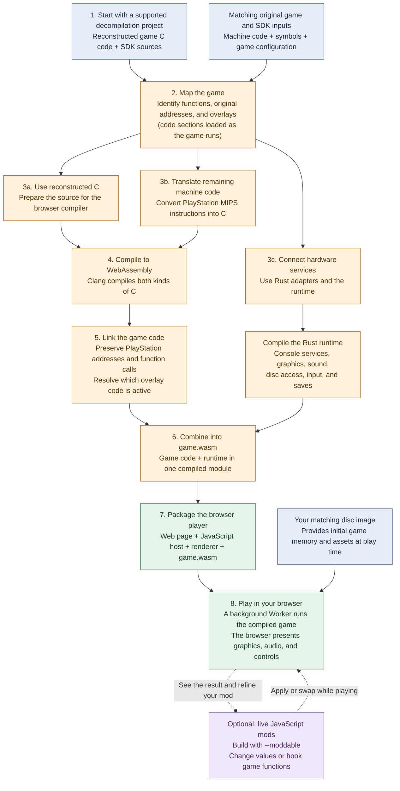

# PlayStation to Web

**Play, debug, and remix original PlayStation games in your browser. Vibe the game as you play.**

**[Open the arcade — play in your browser](https://steveseguin.github.io/playstation-to-web/)**

Try **Paddle Rally** and **Brick Shift**, two free, original PS1 homebrew games.
Choose a game, press **Play now**, and find its controls below the screen.
No disc or BIOS upload is needed. Each game has an **Apply mod** drawer;
the hosted demos do not have mods yet.

The arcade currently plays these homebrew games through EmulatorJS. They are
not yet compiled with `psxw`. The compiler and its live JavaScript mod tools
described below are a separate path. [Arcade source, licenses, and setup](demos/README.md).

PlayStation to Web turns supported PlayStation 1 games into programs that run
directly in a web browser. It also lets you modify a game while you're playing:
change its rules, tweak values, and try new behavior through JavaScript mods
without restarting your session.

The compiler's first game is **Harvest Moon: Back to Nature**. This is an early developer
project built around that game's decompilation (reconstructed source code).
Other games need their own source project and integration; you cannot just
drop in any PlayStation disc and expect it to work.

## What can you do with it?

- **Play in your browser**, with keyboard or gamepad controls, sound, and saved games.
- **Remix a game live.** Load or replace JavaScript mods during play, change game
  values, and alter what game functions do. A mod can change rewards, adjust
  difficulty, or try out a new mechanic.
- **Vibe the game as you play.** Write a mod yourself or use an AI coding assistant
  to help write it, load it into your running game, and keep iterating. Live
  changes use the mod tools; there is no built-in AI chat interface.
- **Look under the hood.** Inspect game state and set breakpoints in the game's
  C code using browser developer tools.

[Watch the demo and walkthrough](https://youtu.be/6qEwwaCxalc).

## How does it work?

The project compiles reconstructed game code into **WebAssembly**, a format that
lets browsers run compiled programs. It translates remaining PlayStation machine
code ahead of time and supplies the graphics, audio, input, and disc services
the game needs.

**Decompilation happens upstream:** people reconstruct the game's source in a
separate project. `psxw` uses that work and translates the remaining machine code
before play. The resulting WebAssembly runs the compiled game in the browser.
The public arcade's EmulatorJS demos use a separate playback path.

For compiled commercial games, you supply the matching game's disc image
(`.cue` and `.bin` files) for its assets. Commercial game discs and assets are
not included in this repository or the public arcade.

## Getting started

Building a game currently requires developer tools and setup. The command-line
tool is called **`psxw`**; existing commands and configuration filenames still
use that short name.

- [Developer setup and build commands](README.slop.md)
- [Browser controls, saves, and live JavaScript mods](web/README.md)
- [How the compiler and runtime work](docs/design.md)
- [Development progress and remaining work](plans/README.md)

APIs and game support are still evolving. Expect rough edges, especially when
bringing another game into the project.
